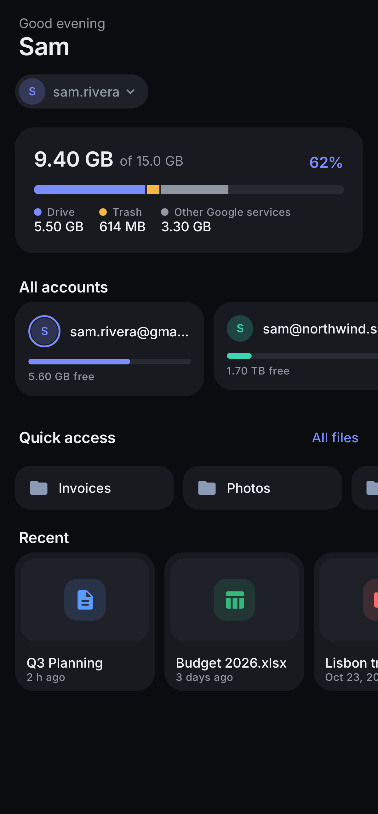
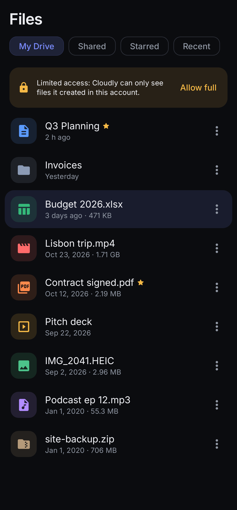
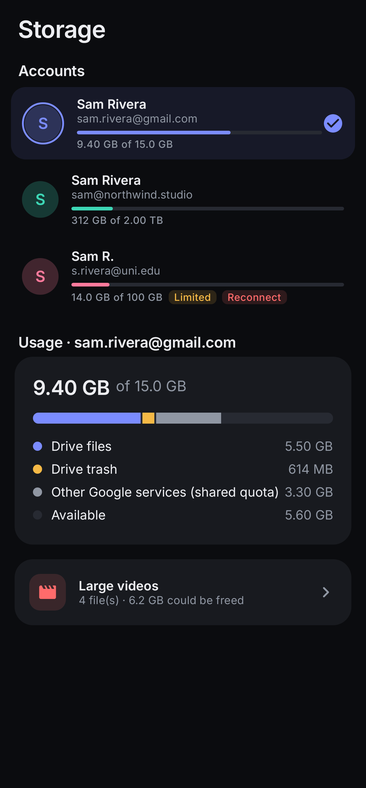
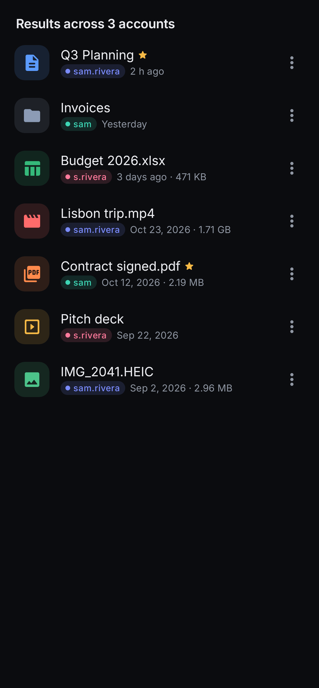
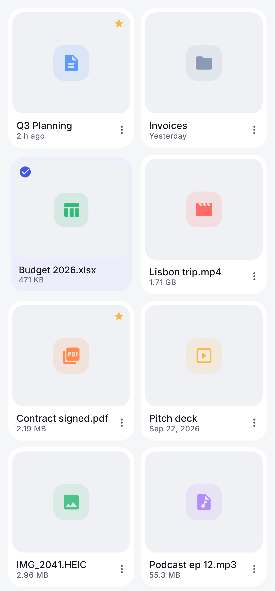

# Cloudly — Multi-Account Google Drive Manager

Cloudly is an Android app for managing several Google Drive accounts in one place: browse, organise, preview, transfer and clean up files across every Drive you use. It handles Google Drive only. There's no Gmail, Calendar or Photos integration, and Cloudly has no account system of its own.

| Home | Files | Storage | Search across accounts | Light theme |
|---|---|---|---|---|
|  |  |  |  |  |

*These screenshots are rendered from the real Compose components with sample data (Robolectric + Roborazzi, see `ScreenshotTest`), not captured from a device.*

## Features

- **Multiple Google accounts.** Sign in with Google (Credential Manager + Identity AuthorizationClient). You can add, switch, remove or reconnect accounts, set a default, and see each account's profile picture and storage. Every account has its own colour, so you can always tell which account a file belongs to.
- **Dashboard.** A greeting, a compact account switcher, a storage breakdown, mini storage cards for all accounts, quick-access folders, and recent, starred and recently modified files. There's also a quick upload button.
- **File explorer.**
  - Views: My Drive, Shared, Starred and Recent, with breadcrumbs, a grid/list toggle and sorting (name, date, size, type).
  - Paging: lists load the next page automatically as you scroll, and you can pull to refresh.
  - Actions: create folders, rename, move, copy (folders are copied recursively), move to trash, star, upload (Photo Picker or Storage Access Framework), download, share a file or a link, open with another app, open in Drive, and view details.
  - Multi-select with bulk actions.
- **Cross-account management.**
  - Search: one search runs across all accounts or just one. Results carry account badges, and one account failing doesn't hide the others.
  - Copy or move between accounts: files are downloaded from one account and uploaded to the other in the background. Google Docs, Sheets and Slides are exported to Office formats and converted back on upload. Every transfer needs your confirmation, which names both accounts.
  - Safe moves: a move only puts the originals in the trash, and only after everything copied successfully.
- **Previews.**
  - Images, with pinch-zoom.
  - Video and audio, streamed by Media3 using the owning account's token.
  - PDFs, including Google Docs, Sheets and Slides exported to PDF.
  - Text and code files.
- **Storage management.**
  - Usage per account (Drive, trash, other Google services, free).
  - A breakdown by file type, computed from your largest files.
  - The largest files, and suggestions for large videos, old large files and duplicates (same MD5 checksum).
  - Trash: restore, delete forever, or empty the trash.
  - Nothing is ever deleted automatically. Moving to trash and permanent deletion always ask for confirmation.
- **Settings.**
  - Accounts: manage accounts and choose the default.
  - Appearance: theme (dark by default, light or system) and the default layout.
  - Transfers: download location (Downloads/Cloudly or any folder you pick), a Wi-Fi-only option, and the transfer history.
  - Device storage: clear the cache.
  - Privacy information and About.
- **Background transfers.** Transfers run under WorkManager with a foreground notification. Uploads are chunked and resumable, transient errors are retried with backoff, and you can retry or cancel from the Transfers screen.

## Authorization and scopes

Cloudly asks for **one Drive scope per account**, and you choose it when connecting:

| Choice | Scope | What Cloudly can see |
|---|---|---|
| Full Drive access (recommended) | `https://www.googleapis.com/auth/drive` | Everything in the Drive, which a file manager needs |
| Only files created with Cloudly | `https://www.googleapis.com/auth/drive.file` | Only files uploaded or created through Cloudly |

`drive.file` does **not** grant access to existing files. Cloudly records the scopes Google actually *granted*, not the ones it requested. When an account has limited access, a banner explains this and offers an upgrade instead of showing an apparently empty Drive.

`drive` is a **restricted** scope. You can use it during development with test users. A public release needs Google's OAuth verification and security assessment.

**Security notes**

- No passwords are handled. No refresh tokens are stored either: Google Play services keeps the grant.
- Short-lived access tokens are cached encrypted with an AES-GCM key from the Android Keystore, in no-backup storage. App data is excluded from cloud backup and device transfer.
- When an account is added, Cloudly asks Drive which account the token belongs to. If it doesn't match the account you picked, nothing is saved.
- Every Drive call takes an explicit `accountId`. Files carry the account they belong to, and two-file operations refuse to run if the accounts differ.

## Setup

1. Create a Google Cloud project and **enable the Google Drive API**.
2. Configure the **OAuth consent screen**. Add the Drive scope above, and add your Google accounts as test users while the app is unverified.
3. Create OAuth clients:
   - An **Android** client for package `com.halfblanket.cloudly` with your signing certificate's SHA-1 (`./gradlew signingReport`).
   - A **Web application** client. Its ID is what Credential Manager needs to show the account chooser.
4. Put the web client ID in `local.properties`, which isn't committed:
   ```properties
   cloudly.webClientId=1234567890-xxxxxxxx.apps.googleusercontent.com
   ```
   You can also use the `CLOUDLY_WEB_CLIENT_ID` environment variable or the `-Pcloudly.webClientId=…` Gradle property. Without it, Cloudly falls back to letting Google's authorization screen choose the account.
5. Build and run:
   ```bash
   ./gradlew assembleDebug        # app/build/outputs/apk/debug/app-debug.apk
   ./gradlew testDebugUnitTest    # unit + screenshot tests
   ```

Requirements: JDK 17+ and Android SDK 35. The minimum supported Android version is 8.0 (API 26).

## Architecture

```
auth/        GoogleAuthManager (Credential Manager + AuthorizationClient, token source), TokenVault (Keystore), scopes
data/drive/  DriveApi (REST v3 over OkHttp: list/get/create/update/copy/delete, export, resumable upload),
             RetryInterceptor, models, query builders, image auth interceptor
data/db/     Room: accounts, transfers, listing cache
data/prefs/  DataStore settings
data/repo/   AccountRepository, DriveRepository, TransferRepository
work/        WorkManager workers: upload, download, cross-account copy/move; notifications; local file helpers
ui/          Jetpack Compose + Material 3: home, files, search, preview, storage, settings, transfers, onboarding
```

The app uses manual dependency injection (`AppContainer`), ViewModels with `StateFlow`, and type-safe Navigation Compose. Images load through Coil 3, with an interceptor that adds the owning account's token, and only for Google hosts.

## Known limitations

- **Shared drives.** Shared drives (Team Drives) aren't browsed yet. My Drive, Shared with me, Starred and Recent are.
- **Cross-account transfers.** Sharing permissions, comments and revision history aren't copied. Forms, Sites and shortcuts can't be exported, so they're skipped and reported. If a multi-item transfer fails partway, it isn't re-run automatically, to avoid duplicating items.
- **Sort by type.** Drive's API can't sort by type on the server, so this sort only applies to the items already loaded.
- **Type breakdown.** The per-type storage breakdown is based on up to your 2,000 largest files. Drive doesn't expose per-type quota figures, and the UI says so.
